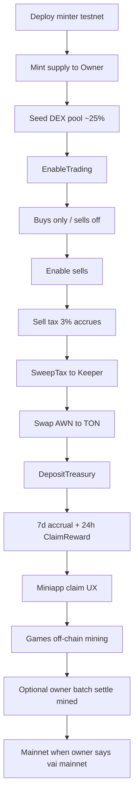

# $AWN (AwanToken) — Project brief for AI review

Use this document to understand what was built, how the smart contract works, and how the miniapp/admin fit together. Network focus today: **TON testnet**. Mainnet is intentionally blocked until the owner says “vai mainnet”.

---

## 1. What this project is

**AwanToken ($AWN)** is a TON jetton (TEP-74 / TEP-89) written in **Tact**, plus:

| Layer | Path | Role |
|--------|------|------|
| Smart contracts | `contracts/awan_token.tact` | Minter + jetton wallets, DEX limits, sell tax, weekly claim |
| Deployments | `deployments/testnet.json` | Live testnet addresses |
| Scripts | `scripts/` | Deploy, pool setup, sell/claim tests, SweepTax |
| Telegram miniapp | `miniapp/` | Vite + React + TonConnect UI for users |
| Admin Command Deck | `admin/` | Owner-only ops UI (localhost) |
| Hosting | Vercel | Public miniapp: `https://awn-miniapp-vercel.vercel.app` |
| Bot | Telegram | `https://t.me/AwanToken_bot/app` |

Games (Neon Siege, AWN Run) mine **off-chain** `$AWN` in `localStorage`. That is **not** on-chain mint. Future settlement is meant to come from the **claim pool / owner batch**, not free mint.

---

## 2. Token economics (on-chain)

- **Symbol:** `$AWN` / AwanToken  
- **Decimals:** 9  
- **Fixed supply:** `1_000_000_000` $AWN (all minted to Owner at init)  
- **DEX pool liquidity (intended):** ~25% of supply sent to pool after deploy (manual / scripts)  
- **Trading phases:**  
  - Phase 1: trading ON, sells OFF → buys only  
  - Phase 2: sells ON → sell tax fills the treasury path; claim program can run  

### Anti-dump / DEX limits (basis points, 10000 = 100%)

| Rule | Default | Meaning |
|------|---------|---------|
| Max buy / tx | 50 bp = **0.5%** | Of **current pool** `$AWN` balance (not total supply) |
| Max sell into pool / tx | 50 bp = **0.5%** | Of **current pool** `$AWN` balance |
| Possession sell cap | 50 bp = **0.5%** | Of **seller’s own wallet** balance (anti full-bag dump) |

Limits can be toggled with `isDexLimitsEnabled`.

### Sell tax → treasury (claim fuel)

1. On sell **into the DEX pool**, **3%** of the sell amount stays as `$AWN` tax (accrues as `pendingTaxJettons` on the minter).  
2. Owner calls **`SweepTaxJettons`** → moves tax `$AWN` from minter jetton wallet → **Keeper**.  
3. Keeper **swaps** `$AWN` → TON/GRAM on a DEX (manual, e.g. DeDust / Ston.fi).  
4. Keeper (or Owner) calls **`DepositTreasury`** → TON enters minter **treasury** (`treasuryGramBalance`).  
5. That treasury funds the **weekly claim** payouts to holders.

Current testnet treasury (as of last check): **~0.17 TON**.  
`claimPoolSnapshot` is **0** until a claim window opens and snapshots the pool.

---

## 3. Weekly claim system (smart contract)

Constants:

- Accrual period: **7 days** (`CLAIM_PERIOD_SECONDS = 604800`)  
- Claim window: **24 hours** (`CLAIM_WINDOW_SECONDS = 86400`)  
- Anti-sniper penalty: **50%** payout if eligibility rules fail (`ANTI_SNIPER_PENALTY_BP = 5000`)

### Lifecycle

1. Claim program becomes active when sells are enabled (treasury path makes sense).  
2. During the 7-day cycle, each holder’s balance is tracked (`HolderInfo`):  
   - `balance`  
   - `minBalancePeriod` (lowest balance in cycle — anti freeloader)  
   - `periodStartBalance`  
   - `claimedCycleId`  
3. When the window opens, the contract snapshots treasury into **`claimPoolSnapshot`**.  
4. Holder sends **`ClaimReward`** during the 24h window.  
5. Payout is **weighted** by holding (full vs penalized). One claim per cycle per holder.

### “In claim pool” in the miniapp Wallet UI

Screenshot text: **“Pool di reclami — Non aderente — compra/tieni $AWN…”**

Meaning in the **app** (not a separate SC membership NFT):

- If the connected wallet’s on-chain `$AWN` **balance > 0** → shown as **aderente** (in the claim pool).  
- If balance is **0** (or fetch failed) → **Non aderente**.  
- Dashes on **TON** / **$AWN** usually mean RPC failed or wallet not fully loaded (rate limits / network), while “rete di test” = **testnet**.

Game-mined pending `$AWN` does **not** by itself make you “aderente”; only **on-chain** jetton balance does.

---

## 4. Smart contract surface (messages / admin)

Core file: `contracts/awan_token.tact`  
Contracts: **AwanToken** (minter) + **AwanWallet** (user jetton wallets).

Important owner/admin messages (non-exhaustive):

| Message | Purpose |
|---------|---------|
| `EnableTrading` | Turn public trading on (one-way style launch switch) |
| `SetSellEnabled` | Start/stop sells |
| `SetDexLimits` | Toggle buy/sell/possession limits |
| `PushWalletConfig` / report balance | Sync DEX pool jetton balance into config for % limits |
| `Blacklist` / unblock | Block addresses |
| `SweepTaxJettons` | Move accumulated sell-tax `$AWN` → Keeper |
| `DepositTreasury` | Deposit TON into claim treasury |
| `ClaimReward` | User claim during window |
| `ForceOpenClaimWindow` | Owner-only: open 24h claim window immediately (skip 7d wait; for testnet/ops) |
| `BatchTransfer` / jetton transfer | Airdrops / settlements (max 150 recipients; default cap 150k $AWN) |
| `ChangeOwner` | Ownership transfer / renounce |

Getters used by apps:

- `get_jetton_data`, `get_wallet_address`  
- `get_trading_state` / config  
- `get_treasury_balance`  
- `get_pending_tax_jettons`  
- `get_claim_status`  
- `get_holder_info(address)`  

### Testnet deployment (reference)

From `deployments/testnet.json`:

- **Minter:** `EQBeUwYSlqxeo1lBGIeStqXPHvyNkZkz8VcykAdPLVF10hzW`  
- **Owner:** `EQCt2RzaUaa5VRIWuf31grbI4yqrBr10Vpg2TRyPDXlEtSQP`  
- **Owner jetton wallet:** `EQDRBdU4cghZ0R-_QalEH-iWceLq89oP5D8TqGjobqBraVBU`  
- **DEX pool:** `EQCQb3D67qlntr6kORNyEhQKd4F9TDBUvRY12P5t-GNxHmgP`  
- Explorer: `https://testnet.tonviewer.com/EQBeUwYSlqxeo1lBGIeStqXPHvyNkZkz8VcykAdPLVF10hzW`

---

## 5. Miniapp (Telegram)

Stack: Vite, React, TonConnect UI, i18n (IT/EN/RU/ZH), Spotify + game mute dock.

### Tabs

- **Trade** — mock DEX chart (UI); buy/sell links explorer for now  
- **Wallet** — TON / $AWN balances, claim-pool membership badge, claim history (local), contract links  
- **Claim** — cycle status, eligibility, claim CTA when window open  
- **Games** — Neon Siege (vertical shooter) + AWN Run (platformer); economy in `localStorage`  
- **Roadmap** — in-app SC / product specs  
- **Board / Classifica** — ranks UI  

### App status (Coming Soon / Live)

- File: `miniapp/public/app-status.json` (`global`, `games.siege`, `games.run`: `"live"` | `"coming"`)  
- Public Owner PIN panels were **removed** from Games (security).  
- Owner drafts toggles in **admin Command Deck**, then updates `app-status.json` + redeploy.  
- Legacy `localStorage` overrides are cleared so browsers don’t stay stuck on “in arrivo”.

### Branding header

- Logo + `$AWN` under logo  
- Centered neon **AWAN** + **TESTNET** pill under it  
- Languages + music + Connect Wallet on the right (no overlap)

### Live URLs

- Vercel: `https://awn-miniapp-vercel.vercel.app`  
- TonConnect manifest: Vercel HTTPS (required; localhost manifests fail for mobile wallets)  
- Dist for Drop: `Desktop/awn-miniapp-vercel` after `npm run miniapp:build`

---

## 6. Admin Command Deck

Path: `admin/` — run locally (`npm run dev` → `http://localhost:5173`).

Owner-only:

- Live telemetry (treasury, supply, trading/sell flags, claim timer)  
- Enable trading / sells / DEX limits  
- Holder radar, blacklist  
- Send `$AWN` / batch airdrop  
- Keeper path: SweepTax → (manual swap) → DepositTreasury  
- **Miniapp Coming Soon / Live** JSON generator (copy → paste into `app-status.json`)  
- Dangerous: renounce ownership  

TonConnect for admin uses the **public HTTPS** Netlify manifest (localhost URL alone breaks wallet connect).

---

## 7. Off-chain game economy vs on-chain

| Concept | Where | Notes |
|---------|--------|------|
| Spendable / gold / mined pending | Miniapp `localStorage` | Fun + pending mined counter |
| Owner mined claim queue | Was miniapp Owner UI; settlement via admin **BatchTransfer** | Not free mint |
| Real `$AWN` | Jetton wallets on TON | Buy/hold → claim eligibility |
| Claim TON payouts | Minter treasury | From sell-tax path |

Constraint remembered by the team: **do not deposit TON into the pool** until the owner explicitly asks; **no mainnet** until “vai mainnet”.

---

## 8. High-level roadmap (product / tech)

### Done (testnet)

- [x] Tact jetton + limits + tax + claim  
- [x] Deploy + pool setup + trade/sell-claim tests  
- [x] SweepTax path verified  
- [x] Miniapp + Telegram bot + Netlify  
- [x] Admin Command Deck  
- [x] Games + Coming Soon via `app-status.json`  
- [x] Hide Owner PIN UI from public Games  

### Next / open

- [ ] Keep filling treasury via real sell-tax → sweep → swap → deposit  
- [ ] First full claim window when 7d elapses  
- [ ] Wire Trade tab to real DEX if desired  
- [ ] Game mined → formal settlement policy  
- [ ] Mainnet only on explicit go-ahead  
- [ ] Optional GitHub sync / CI (desktop commits are separate from Netlify Drop)

---

## 9. Key source files for deeper reading

- `contracts/awan_token.tact` — full SC logic  
- `deployments/testnet.json` — addresses  
- `miniapp/src/lib/ton.ts` — RPC getters, claim math helpers  
- `miniapp/src/lib/appStatus.ts` — Coming Soon  
- `miniapp/src/lib/gameEconomy.ts` — off-chain economy  
- `admin/src/App.tsx` + `admin/src/lib/ton.ts` — owner ops  

---

## 10. One-paragraph summary

We built a fixed-supply TON jetton `$AWN` with 0.5% pool/possession trade caps, a 3% sell tax that eventually funds a TON treasury, and a weekly weighted claim with a 24h window and anti-sniper rules. A Telegram miniapp lets users connect wallets, see balances/claim status, play two games that track mined tokens off-chain, and read the roadmap; an admin Command Deck controls trading, tax sweep, treasury deposit, airdrops, and public Coming Soon flags. Live users hit Netlify + the Telegram bot on testnet; mainnet and extra pool TON deposits wait for explicit owner approval.
